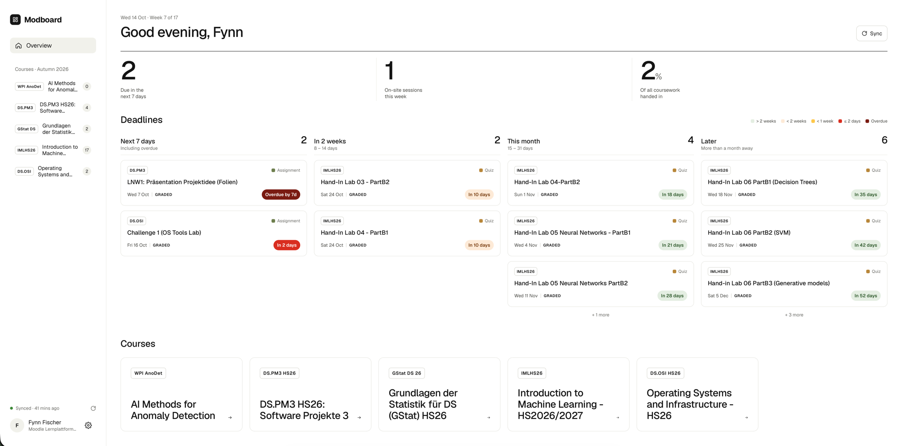
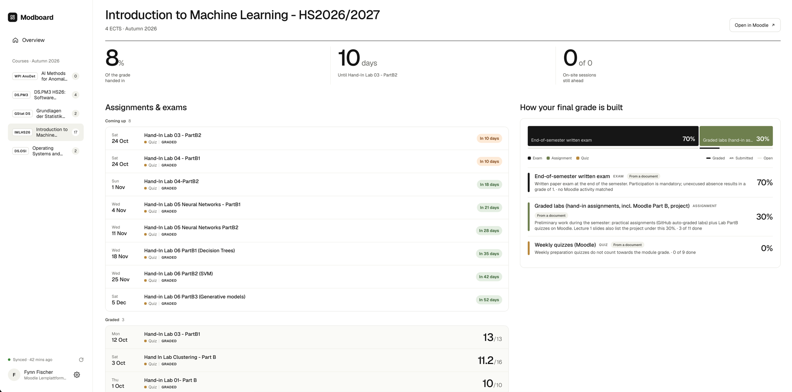

<p align="center">
  
</p>

<h3 align="center">All Your Assignements at One Glance</h3>

<p align="center">Currently supports <code>moodle.zhaw.ch</code></p>

<p align="center"><a href="https://fynnfischer.github.io/modboard/">Documentation</a></p>

## What it is
A read only application that pulls data from all starred moodle courses and extracts assignements, on site lectures and final grade info so that you have all the important info in one place. 

### Extraction Pipeline
1. Pulls all relational data like quizzes.
2. Pulls all documents and texts to fill out missing data with a LLM. 

## Requirements

- Starred courses on moodle. (only those are considered)
- Python 3.12+
- [uv](https://docs.astral.sh/uv/)
- Google Chrome — the SSO login drives it via Playwright. Without it, run
  `uv run playwright install chromium` to use the bundled browser instead.

## Install

```sh
git clone https://github.com/fynnfischer/modboard.git
cd modboard
uv sync
```

## Run

```sh
uv run python app.py
```

Then open <http://127.0.0.1:5000>.

On first use the page asks for an Anthropic API key; it is stored in the OS
keyring. Alternatively put it in `.env`:

```sh
echo 'ANTHROPIC_API_KEY=sk-ant-...' > .env
```

**Sync** runs the pipeline: a Chrome window opens for SWITCH edu-ID login, the
web-service token is captured and stored in the keyring, then courses are
pulled, harvested and read. Subsequent runs reuse the stored token.

## Options

| Flag | Default | |
|---|---|---|
| `--db` | `moodle.sqlite` | SQLite file to read |
| `--host` | `127.0.0.1` | |
| `--port` | `5000` | |
| `--log-dir` | `logs/` | One file per start, 20 kept |


## Notes

- Read-only: the client refuses any web-service function outside the allowlist
  in `src/config.py`.
- A sync rebuilds the database and `corpus/` from scratch.
- Model passes cost tokens — see `SCREEN_MODEL` and `EXTRACT_MODEL` in
  `src/config.py`.

## Contributing

Contributions are welcome. Open an issue or send a pull request.

What is planned and what is in progress is tracked on the
[kanban board](https://github.com/users/fynnfischer/projects/3), other ideas are welcome.

## Demo

<p align="center">
  
  
</p>
